<!-- ===================== HEADER ===================== -->
<!-- Drawn by scripts/neofetch.py: your profile picture as ASCII art plus live stats -->

  

<!-- ===================== ABOUT ME ===================== -->
## 📌 About Me

I like owning projects end-to-end: architecture, implementation, deployment, documentation, and the user experience.

- 🌱 Always shipping something — a client site, a portfolio, a hackathon prototype, coursework, or a robotics side project
- 🎓 Computer Science student in Calgary
- 🤖 Working toward becoming an AI/ML engineer
- 🧮 Currently proving things by induction for fun (and for CPSC 251)

<!-- ===================== GALAXY ===================== -->
<!-- Drawn by scripts/galaxy.py, run daily by .github/workflows/galaxy.yml -->

  

<!-- ===================== STATS ===================== -->
## 📊 GitHub Stats

<!-- Both drawn by scripts/stats.py -->

  
  

<!-- ===================== PROJECTS ===================== -->
## 🚀 Projects

<!-- Drawn by scripts/projects.py. Pick which repos show with FEATURED in that file. -->

  

<!-- ===================== LANGUAGE STACK ===================== -->
<!-- Drawn by scripts/stack.py from the code in your public repos -->

  

<!-- ===================== CONTRIBUTION ACTIVITY ===================== -->
<!-- Drawn by scripts/stats.py. Sweeps in each time the page loads. -->

  

<!-- ===================== TECH STACK ===================== -->
## 🛠️ Languages & Tools

<!-- Edit the list after i= to match what you actually use. Full icon list: https://skillicons.dev -->

  

<!-- ===================== CONNECT ===================== -->
## 🔗 Connect with Me

<!-- Don't edit between the LINKS markers: it's rebuilt from links.txt every run. -->
<!-- LINKS:START -->

  

<!-- LINKS:END -->

<!-- ===================== SNAKE ===================== -->
<!-- Drawn by scripts/snake.py from your contribution graph -->

  

