<!-- ===================== HEADER ===================== -->
<!-- A wavy gradient banner. Change text=, color=, height= in the URL to restyle it. -->

<!-- Typing animation. Each line is separated by ; and spaces are written as + -->

  

<!-- ===================== ABOUT ME ===================== -->
## 📌 About Me

- 🎓 Computer Science student in Calgary
- 🤖 Working toward becoming an AI/ML engineer
- 🛠️ Currently building **Jarvis**, a voice + text personal AI assistant
- 🌱 Learning: Python, machine learning, and how real AI systems are built
- ⚽ Off the keyboard: soccer

<!-- ===================== GALAXY ===================== -->
<!-- Drawn by scripts/galaxy.py, run daily by .github/workflows/galaxy.yml -->

  

<!-- ===================== STATS ===================== -->
## 📊 GitHub Stats

<!-- Both drawn by scripts/stats.py -->

  
  

<!-- ===================== PROJECTS ===================== -->
## 🚀 Projects

<!-- Drawn by scripts/projects.py. Pick which repos show with FEATURED in that file. -->

  

<!-- ===================== LANGUAGE STACK ===================== -->
<!-- Drawn by scripts/stack.py from the code in your public repos -->

  

<!-- ===================== TECH STACK ===================== -->
## 🛠️ Languages & Tools

<!-- Edit the list after i= to match what you actually use. Full icon list: https://skillicons.dev -->

  

<!-- ===================== CONNECT ===================== -->
## 🔗 Connect with Me

<!-- Don't edit between the LINKS markers: it's rebuilt from links.txt every run. -->
<!-- LINKS:START -->

  
  

<!-- LINKS:END -->

<!-- ===================== SNAKE ===================== -->
<!-- Drawn by scripts/snake.py from your contribution graph -->

  

<!-- Footer wave (the same banner, flipped) -->

